<!-- ahmedhassnain :: profile README :: hand-coded with tables -->

  
   
  

  <a href="#about">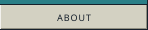</a>
  <a href="#experience">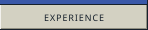</a>
  <a href="#projects">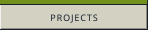</a>
  <a href="#skills">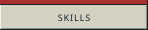</a>
  <a href="#contact">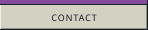</a>

<table>
<tr>
<td width="27%" valign="top">

**name** &nbsp;Ahmed Hassnain 
**based** &nbsp;Kuala Lumpur, MY 
**school** &nbsp;Asia Pacific University 
**degree** &nbsp;B.S. Computer Science 
**years** &nbsp;2025 &ndash; 2028 
**cgpa** &nbsp;3.8 
**mode** &nbsp;front end + design

&raquo; **building** &nbsp;tech ops for *Between the Blocks* 
&raquo; **studying** &nbsp;AWS Cloud Practitioner 
&raquo; **then** &nbsp;AWS Data Engineer Associate 
&raquo; **leading** &nbsp;marketing &amp; design at the Competitive Programming club

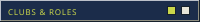

**Competitive Programming club** 
Head of Marketing &amp; Design, R&amp;D department

**Between the Blocks** 
APU's newsletter club: research and technical operations

<kbd>AWS</kbd> Cloud Practitioner <i>(in progress)</i> 
<kbd>AWS</kbd> Data Engineer, Associate <i>(in progress)</i> 
<kbd>Udemy</kbd> Full-Stack Web Development, Angela Yu

 best viewed at 1024&times;768

<a href="mailto:ahmedhassnain@outlook.com">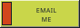</a>
<a href="https://www.linkedin.com/in/ahmed-hassnain">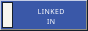</a>
<a href="https://www.instagram.com/ahmeddoescreative">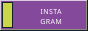</a>

ahmedhassnain@outlook.com

</td>
<td width="73%" valign="top">

**hi, i'm ahmed.** I'm a computer science student at Asia Pacific University in Kuala Lumpur, and I build front ends people actually enjoy clicking through. So far that's meant a real-time network analytics dashboard for a telecom in Riyadh, a headless storefront for a Pakistani fashion brand, and the website for my uni's newsletter club.

Before the code there was design: mascots, branding and promo graphics, plus three years editing podcasts for a US media company. So I care how things look and feel as much as how they work.

**Go Telecom** &nbsp;&middot;&nbsp; Front-End Developer Intern 
2026 &nbsp;::&nbsp; Riyadh, Saudi Arabia
- Built **GoEye**, a full-stack QoS dashboard comparing ISP performance in real time
- React 19 + Recharts front end, FastAPI + PostgreSQL back end, on Vercel, Render and Neon
- JWT role-based auth, a SamKnows-compatible ETL pipeline, multi-scope KPI comparisons

**Quid Sol** &nbsp;&middot;&nbsp; Front-End Designer Intern 
2023 &nbsp;::&nbsp; Pakistan
- UI development and promo design for a new AI-powered web app
- Designed the mascots and branding graphics used across the company site

**Modry Media** &nbsp;&middot;&nbsp; Podcast Editor 
2022 &ndash; 2025 &nbsp;::&nbsp; United States (remote)
- Edited, mixed and mastered episodes from raw recordings to broadcast-ready audio

<a href="https://github.com/ahmedhassnain/goeye-dashboard">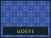</a>
<a href="https://github.com/ahmedhassnain/goeye-dashboard"><b>goeye-dashboard</b></a> &nbsp;2026 
QoS analytics for Go Telecom: SamKnows data for 28 games, 6 social platforms and 4 conferencing tools, as charts and heatmaps. ETL pipeline plus JWT auth on a free-tier stack. 
<kbd>React</kbd> <kbd>FastAPI</kbd> <kbd>PostgreSQL</kbd> <kbd>Python</kbd>
 

<a href="https://github.com/ahmedhassnain/khatoot-website">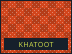</a>
<a href="https://github.com/ahmedhassnain/khatoot-website"><b>khatoot-website</b></a> &nbsp;2026 
Headless storefront for Khatoot, a Pakistani clothing brand. Live variant pricing, a persistent cart and Shopify checkout, with an envelope-and-stamp product reveal. 
<kbd>React</kbd> <kbd>Shopify GraphQL</kbd> <kbd>JavaScript</kbd>
 

<a href="https://github.com/ahmedhassnain/hr-masters-ksa">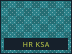</a>
<a href="https://github.com/ahmedhassnain/hr-masters-ksa"><b>hr-masters-ksa</b></a> &nbsp;2026 
Corporate site for a recruitment firm in Saudi Arabia, with Framer Motion transitions through the job-seeker flow. 
<kbd>React</kbd> <kbd>CSS</kbd> <kbd>Framer Motion</kbd>
 

<a href="https://github.com/ahmedhassnain/between-the-blocks">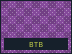</a>
<a href="https://github.com/ahmedhassnain/between-the-blocks"><b>between-the-blocks</b></a> &nbsp;2026 
The website for APU's newsletter club, styled like a 2000s web portal. This README borrows its look. 
<kbd>HTML</kbd> <kbd>CSS</kbd> <kbd>JavaScript</kbd>
 

</td>
</tr>
<tr>
<td colspan="2">

**languages** &nbsp; <kbd>JavaScript (ES6+)</kbd> <kbd>HTML5</kbd> <kbd>CSS3</kbd> <kbd>Python</kbd> <kbd>SQL</kbd> <kbd>C</kbd> <kbd>C++</kbd> <kbd>Java</kbd> 
**frameworks** &nbsp; <kbd>React</kbd> <kbd>Node.js</kbd> <kbd>FastAPI</kbd> <kbd>Bootstrap</kbd> <kbd>SQLAlchemy</kbd> <kbd>Recharts</kbd> <kbd>Axios</kbd> <kbd>Framer Motion</kbd> 
**tools** &nbsp; <kbd>Git</kbd> <kbd>GitHub</kbd> <kbd>VS Code</kbd> <kbd>Vercel</kbd> <kbd>Render</kbd> <kbd>Neon (PostgreSQL)</kbd> 
**design** &nbsp; <kbd>Figma</kbd> <kbd>Photoshop</kbd> <kbd>Illustrator</kbd> <kbd>Canva</kbd>

</td>
</tr>
</table>

  <a href="https://github.com/ahmedhassnain/between-the-blocks">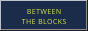</a>
  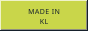
  
  
    
  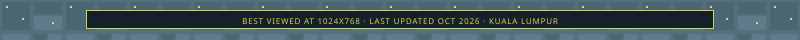

